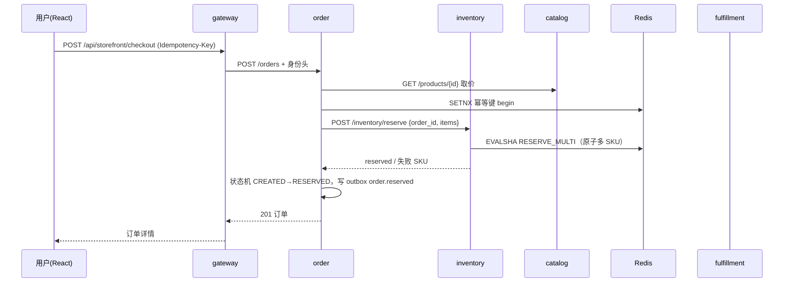
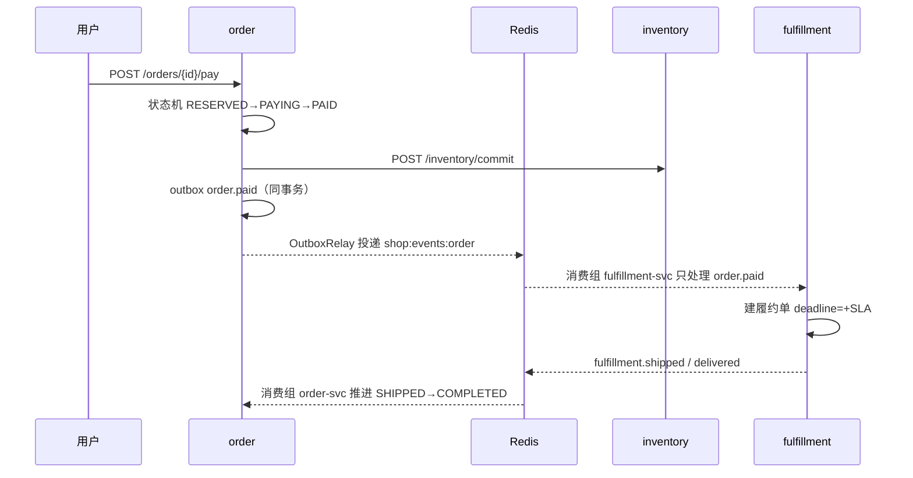

# 架构设计

## 1. 分层

```
体验层      web (React 18 + Vite)
            商城 / 订单售后 / 运营后台 / Agent 对话与证据
                 │ /api/*（同源代理）
接入层      gateway (FastAPI)
            鉴权（JWT→身份头）/ 分钟级限流 / BFF 聚合 / 反向代理 / SSE / 审计
                 │
控制面      harness
            SKILL 准入 → 信任分级 → 工具网关 → 人工审批 → DLP → 证据账本
            沙箱（Docker/本地）/ MCP 协议层 / 三层记忆 / Agent Runtime
                 │ 工具调用（HTTP）
数据面      catalog · inventory · order · fulfillment · aftersales
            每服务独立数据库，服务间只通过 HTTP 契约与事件通信
                 │
基础设施    MySQL 8（每服务独立库）/ MongoDB 7（Harness 文档）/ Redis 7（库存原子脚本 + Streams + 幂等 + 工作记忆）
```

### 数据所有权

| 服务 | 数据库 | 拥有的数据 | 明确不拥有 |
|---|---|---|---|
| catalog | catalog_db | 商品、类目、上下架状态 | 库存、价格快照之外的订单数据 |
| inventory | inventory_db | 库存总数/预占、预占单 | 订单状态 |
| order | order_db | 订单、金额、状态轨迹、地址 | 库存、物流轨迹 |
| fulfillment | fulfillment_db | 履约单、SLA、运单号 | 订单金额 |
| aftersales | aftersales_db | 售后单、风险评分、审批结论 | 订单状态（只能发事件申请） |
| harness | MongoDB `shop_harness` | 记忆（情节/语义）、Agent 运行轨迹 | 任何业务主数据 |

## 2. 一次下单的时序



支付与履约：



## 3. 一致性设计

### 3.1 库存：为什么必须用 Lua

典型超卖写法是 `GET → 判断 → DECRBY`，两个请求都能通过判断。本实现把「检查 + 扣减 + 预占标记」放进一个 Lua 脚本，Redis 单线程执行，天然原子：

- `RESERVE_MULTI`：一次校验多个 SKU，任一不足则整体失败，返回失败 SKU 与可售量。
- `COMMIT_ORDER`：支付成功后把预占转为真实扣减。
- `RELEASE_ORDER`：取消/失败释放预占。
- `SEC_KILL`：秒杀独立库存键，`SISMEMBER` 每人限购 1。
- `SYNC_STOCK`：DB 为真相源，重启时补热库存，不覆盖已有键以避免清零在途预占。

DB 只做落库与对账：预占成功后再写 `reservations` 与 `stocks.reserved`；写库失败调用释放脚本回滚。30s 扫描把超时未支付预占回补。

### 3.2 订单：状态机 + Outbox

- 所有状态变更必须走 [state_machine.py](../services/order/state_machine.py) 的 `TRANSITIONS`，服务层不直接赋值 `status`。
- 退款驳回需要 `refund_previous` 才能回到来源状态，避免「驳回后订单凭空变成已完成」。
- 业务写入与事件入 `outbox_events` 在同一事务提交，`OutboxRelay` 每 0.5s 投递；投递失败记录 `attempts/last_error` 下轮重试。
- 消费者用 `shop:dedupe:{topic}:{group}:{event_id}` 做幂等，成功后才 `XACK`，失败删除去重键并留在 pending。

### 3.3 事件契约

| topic | 事件类型 | 生产者 | 消费者 | 说明 |
|---|---|---|---|---|
| `order` | `order.created / reserved / cancelled / paid / refunding` | order | fulfillment | fulfillment **只处理** `order.paid` |
| `fulfillment` | `fulfillment.sla_breached / shipped / delivered` | fulfillment | order | 推进订单状态 |
| `aftersales` | `after-sales.approved / rejected / refunded` | aftersales | order | 退款申请、驳回回滚、退款完成 |

新增消费者时必须显式按 `event["type"]` 过滤——同一 topic 会收到多种事件，这是回归测试覆盖点（`tests/test_event_handlers.py`）。

## 4. Harness 控制面

```
SKILL.md ──load──> Manifest ──audit──> findings ──(high)──> 拒绝加载
                        │
                        ▼
                   trust tier (T1..T4)
                        │
tool_calls ──> ToolRegistry.execute
   1) enforce(trust, policy)        权限 / 数据等级 / 不可逆动作
   2) requires_approval?            落 pending，返回 needs_approval
   3) handler                       调业务服务 / 沙箱 / MCP
   4) redact                        手机号、身份证、邮箱脱敏
   5) TraceLedger.append            每次调用都留证据
```

- **准入六类 finding**：`preprocessing-command`、`undeclared-tool`、`unlisted-script`、`path-escape`、`network-egress`、`dependency-risk`；`high` 直接拒绝。
- **信任上限**：`community(T1)` 只读 skill 目录；`reviewed(T2)` 可写 skill 目录但无执行权；`vendor(T3)` 可执行、可访问 PII；`certified(T4)` 额外可访问 secrets 与声明式写路径。manifest 写什么都无法越过这张表。
- **审批边界**：`after_sales_approve` 标记 `risk=irreversible + requires_approval`，Agent 只能提议；审批接口要求 staff。
- **证据**：`run.start / agent.step / tool.call / tool.result / approval.requested / run.end` 逐行写 JSONL；证据卡包含 trace 的 sha256。
- **MCP**：`MCPServer.handle` 支持 `initialize / ping / tools/list / tools/call`，错误以 JSON-RPC error 返回；`MCPHub` 可把外部 MCP 工具注册进同一 Registry，统一走权限与审计。

### 记忆分层

| 层 | 存储 | 写入时机 | 读取 |
|---|---|---|---|
| 工作记忆 | Redis list `shop:mem:work:{session}` | 每轮对话 | 最近 6–8 条注入 prompt |
| 情节记忆 | MongoDB `memory_records` | 每轮 + 显式 remember | 混合打分召回 top-k |
| 语义事实 | 同上（`kind=semantic`） | 正则抽取（称呼/地址/偏好/过敏） | 重要性 0.85，长期保留 |

召回分 `0.6*cosine + 0.25*importance + 0.15*recency`，相似度 ≥0.92 视为重复并更新，避免记忆膨胀。向量默认由确定性哈希 n-gram 生成（每 gram 三次投影降碰撞），离线可用；配置 `EMBEDDING_BASE_URL` + `EMBEDDING_API_KEY` 后自动切换为 OpenAI 兼容 `/embeddings` 的真实语义向量，端点故障回退哈希并打 `embedding_fallback_total` 指标。每条记录落盘带 `embedder` 标签，召回与去重只比较同维度向量，换模型后旧向量自动跳过（宁可少召回不误召回）。

## 5. 网关

- `Authorization: Bearer` → 校验 → 向业务服务透传 `X-User-Id / X-User-Role / X-Tenant`；业务服务直连时也能回退到 JWT 或访客身份。
- 限流：Redis 分钟窗口计数 120/min，登录接口豁免。
- BFF：`/api/storefront/feed` 聚合商品与库存；`/api/storefront/checkout` 透传幂等键；`/api/storefront/orders` 聚合订单。
- 反向代理 `/api/{service}/{rest}`：白名单服务别名，不在名单内直接 404。
- SSE：包含 `chat/stream` 的路径使用流式转发并延长超时；nginx 侧关闭缓冲。
- 审计：写 `shop:audit` 列表（保留 5000 条），记录用户、角色、方法、路径。

## 6. 安全边界（必须如实说明）

1. 本地沙箱子进程**不是**安全边界，只能防误操作；Docker 模式才关闭网络、只读 FS、限制 CPU/内存/PID 并 `no-new-privileges`。
2. 工具脱敏是最后一道展示层防线，不替代数据库字段级加密与最小权限账号。
3. Skills 准入是静态检查，语义判断只做降级建议；真正的运行时约束靠信任分级与工具策略。
4. evidence 卡证明「这次运行确实调用了这些工具并得到这些结果」，不证明业务结论正确。
