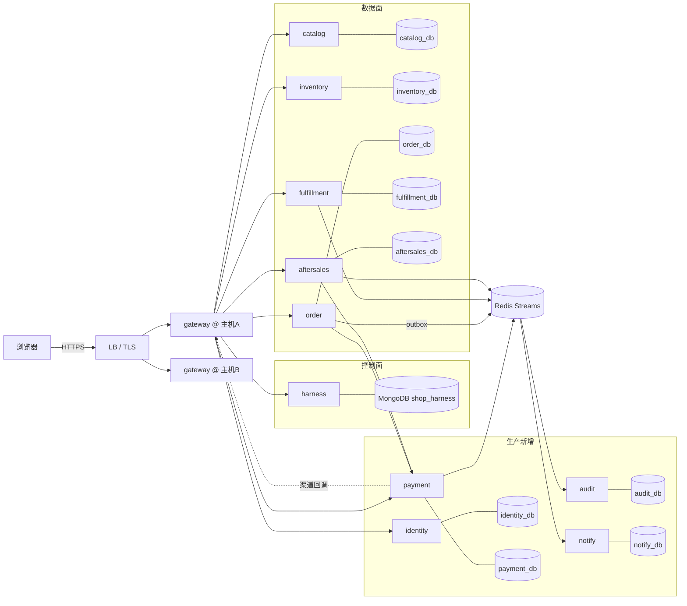
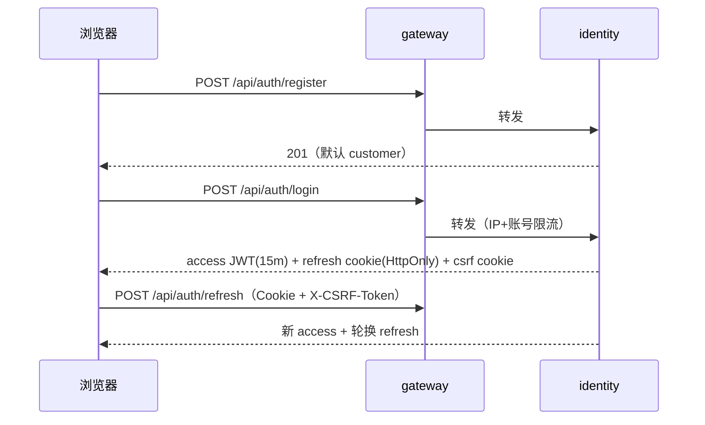
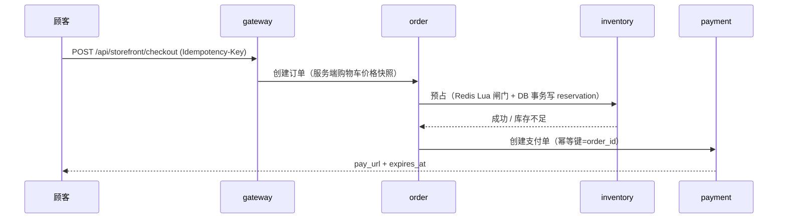
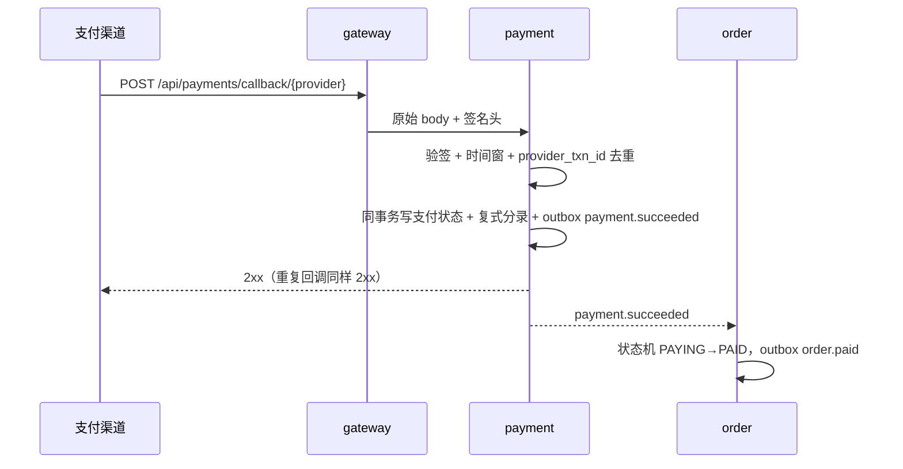

# shop-agent 系统设计（生产基线）

> 状态：**已冻结（修订版 2026-11-06）**。本版取代此前的“可上线 MVP”版本：单机 Compose、整单退款、无总账、Redis 即库存真相、进程内 relay、本地沙箱兜底等设计不再适用。本修订版闭环库存-支付竞态、补总账分录模板与退款分摊、订单状态机补 SHIPPING、消费去重与 DLQ 落库、明确三高容量基准与验收，详见 13.1 修订记录。
> 需求来源：[requirements-shop-agent.md](../requirements/requirements-shop-agent.md)；规模与 SLO 见第 1 节。

---

## 1. 定位与生产基线

**定位**：业务数据面 + Harness 控制面的混合架构。电商核心链路由业务服务承载；Harness 只负责 Agent 的技能准入、信任分级、工具网关、沙箱、记忆与证据，不是全系统架构。

| 项目 | 冻结值 |
|---|---|
| 生产标准 | 生产级非功能 + 真实交易闭环；功能守 V1 边界 |
| 峰值 | 下单 30 TPS、浏览 300 QPS、SKU 5 万、日订单 3 万；事件量日约 30 万条、峰值约 150 条/秒 |
| 可用性 | 单区域 99.5%，下单 P95 <800ms |
| 部署 | 两台应用主机跑 Compose，前置 LB，MySQL/MongoDB/Redis 托管，不引入 K8s |
| 租户 / 仓 | 单租户（全表预留并强制过滤 `tenant_id`）；单仓（预留 `warehouse_id`） |
| 资金 | 独立 `payment` 服务；聚合支付托管收银台；内部复式总账 + 日终对账 |
| 库存 | DB 为最终真相，Redis Lua 为原子闸门；允许极短少卖，绝不超卖；Redis-DB 库存对账为上线 Must（5 分钟粒度） |
| 订单 | 部分发货、部分退款、退货退款；换货/拒收放 Should |
| 数据 | 订单/资金 5 年、审计 180 天、日志 30 天、回调摘要 90 天、备份 30 天 |

**明确不做（V1）**：促销/优惠券引擎、换货/拒收、多仓与调拨、快递 API 自动取号、电子发票 API、第三方风控、社交登录、多租户 SaaS/RLS、K8s、Kafka、多地域多活、自建支付/清结算、存储卡数据、完整等保/ISO 认证、7×24 值班。

---

## 2. 架构

**职责边界**
- `gateway`：验签、限流、BFF、反向代理、SSE；不持有业务主数据，不直连任何业务库，不承担审计落库。
- 业务服务：只拥有自己的库；跨服务走 HTTP 或事件，禁止直连他人数据库。
- `payment`：支付单、退款、拒付、总账、对账；渠道是结算事实，内部账是业务事实。
- `harness`：Agent 控制面，不参与订单/库存/资金写入。
- `audit`：审计落库的唯一入口。业务服务在写操作事务内以 outbox 写 `audit.{action}` 事件，audit 消费落库；不提供同步审计 HTTP 接口。

---

## 3. 部署拓扑（Compose + 双主机）

- 两台应用主机各跑一套 `docker compose -f docker-compose.yml -f docker-compose.prod.yml`；应用无状态，会话不落本机。
- LB 终止 TLS，只转发到两台主机的 `gateway` 与 `web`；其余服务不映射宿主机端口，只在 `backend` 内网可达。
- MySQL/MongoDB/Redis 使用云托管实例（或至少独立主机）；`identity`、`payment`、`audit`、五个业务服务全部走内网。
- 托管组件 HA 下限：MySQL 必须主从 + 自动切换、Redis 必须主从（或云 HA）、MongoDB 副本集；任一托管组件为单点时，99.5% 可用性不成立。
- 生产 overlay：`restart: unless-stopped`、CPU/内存上限、JSON 日志轮转（50MB × 5）、`healthcheck`、`ports: !reset []`（需 Compose v2.24+）。
- 启动顺序：托管 DB/Redis → identity/payment/业务服务 → gateway → web；启动时校验默认密钥直接拒绝启动。
- 单机 Compose 仅用于本地开发；生产双主机 + 托管 DB 才能承诺 99.5%。

---

## 4. 数据模型

所有业务表包含 `tenant_id`，查询强制带租户条件；金额一律 `amount_cents BIGINT`，禁止浮点。

### 4.1 identity_db

| 表 | 关键字段 |
|---|---|
| `users` | `id, tenant_id, phone UNIQUE, email NULL, password_hash, status, created_at, updated_at` |
| `user_roles` | `user_id, role, tenant_id, granted_by, granted_at`，PK(`user_id`,`role`,`tenant_id`) |
| `refresh_tokens` | `id, user_id, token_hash UNIQUE, expires_at, revoked_at, rotated_from, user_agent` |
| `login_attempts` | `key(phone+ip), failed_count, window_start, locked_until` |

角色只能由管理员授予，注册默认 `customer`；密码 Argon2id。

### 4.2 payment_db + 总账

| 表 | 关键字段 |
|---|---|
| `payments` | `id, tenant_id, order_id UNIQUE, provider, provider_txn_id UNIQUE NULL, amount_cents, currency, status, pay_url, expires_at, paid_at` |
| `refunds` | `id, payment_id, ticket_id UNIQUE, amount_cents, status, provider_refund_id UNIQUE, requested_at, completed_at` |
| `chargebacks` | `id, payment_id, provider_case_id UNIQUE, amount_cents, status, opened_at, closed_at` |
| `settlements` | `id, provider, biz_date UNIQUE, gross_cents, fee_cents, net_cents, currency` |
| `ledger_transactions` | `id, tenant_id, type, ref_type, ref_id, currency, created_at`，只增不改 |
| `ledger_entries` | `id, txn_id, account_code, direction(debit/credit), amount_cents` |
| `reconciliation_diffs` | `id, biz_date, provider_txn_id, local_amount, provider_amount, kind, status, created_at` |

**记账不变量**：每笔 `ledger_transaction` 的借方合计 = 贷方合计；冲正用反向分录，不修改历史行。账户：`CASH`、`PROVIDER_RECEIVABLE`、`REVENUE`、`REFUND`、`FEE`、`CHARGEBACK`。

**分录模板**（收入确认时点 = 支付成功；渠道账单是结算事实）：

| 事件 | 分录（借 / 贷） |
|---|---|
| 支付成功 | `PROVIDER_RECEIVABLE` / `REVENUE`（金额 = 实付额） |
| 结算到账 | `CASH` / `PROVIDER_RECEIVABLE`；手续费 `FEE` / `CASH` |
| 退款 | `REFUND` / `CASH`（金额 = 退款额） |
| 拒付 | `CHARGEBACK` / `PROVIDER_RECEIVABLE`（实现随 M3 拒付流程） |

迟到支付（回调到达时支付单已 `expired`）自动发起退款，`ticket_id = latepay-<order_id>`，复用 `refunds` 幂等链路。

### 4.3 order_db / fulfillment_db

| 表 | 关键字段 |
|---|---|
| `orders` | `id, tenant_id, user_id, status, total_cents, shipping_fee_cents, payment_id, pay_url, payment_expires_at, address(JSON 快照), refund_previous, refund_amount_cents, created_at`；订单侧不镜像支付状态，`payment_status` 只存在于 payment 服务 |
| `order_items` | `id, order_id, sku, warehouse_id, qty, unit_price_cents, discount_cents, shipped_qty, refunded_qty, refunded_amount_cents` |
| `order_events` | `id, order_id, from_status, to_status, event, actor, created_at`（唯一轨迹） |
| `shipments` | `id, order_id, warehouse_id, carrier, tracking_no, status, shipped_at` |
| `shipment_items` | `shipment_id, order_item_id, qty` |

订单状态只做宏状态：`CREATED → RESERVED → PAYING → PAID → SHIPPING → SHIPPED → COMPLETED`，分支 `CANCELLED / REFUNDING / REFUNDED`。聚合推进规则：任一 item `shipped_qty > 0` 且未全部发完 → `SHIPPING`；全部 item 发完 → `SHIPPED`；全部 shipment 签收 → `COMPLETED`（部分签收不推进）。物流进度由 `shipments` 表达；状态变更必须经 `resolve_target` 并同事务写 `order_events`。

### 4.4 inventory_db

| 表 | 关键字段 |
|---|---|
| `stock` | `sku, total, reserved, updated_at`，PK(`sku`)；V1 单仓，多仓时演进为 (`warehouse_id`, `sku`) 复合主键 |
| `stock_reservations` | `id, order_id, sku, qty, status(reserved/committed/released), expires_at`，`(order_id, sku)` 唯一；行级预占，`expires_at` = 支付窗口 + 5 分钟缓冲 |
| `stock_adjustments` | `id, sku, delta, reason, operator_id, idempotency_key UNIQUE, created_at`；入库/盘点调整的唯一记录 |

`stock.reserved` 不得大于 `total`；DB 更新用条件写（`WHERE total - reserved >= qty`），行级 reservation + Lua 闸门共同保证并发安全。库存对账任务（Must）：每 5 分钟比对 Redis 数字与 DB `total − reserved`，差异以 DB 为准重建并告警。

### 4.5 aftersales_db / audit_db

| 表 | 关键字段 |
|---|---|
| `after_sales_tickets` | `id, tenant_id, order_id, order_item_id, type(return_refund/refund_only), status, requested_amount_cents, approved_amount_cents, return_tracking_no` |
| `audit_log` | `id, occurred_at, service, actor_id, actor_role, tenant_id, action, target_type, target_id, request_id, before JSONB, after JSONB, ip_hash` |

审计写入：业务服务在写操作事务内以 outbox 写 `audit.{action}` 事件（schema：`actor_id/actor_role/action/target_type/target_id/before/after/request_id/ip_hash`），audit 消费落库；`audit_log` 只增不改，查询仅 admin。

审计 180 天；订单/资金 5 年；日志 30 天；回调原文摘要 90 天；备份 30 天。注销后 30 天内删除可删 PII，资金记录依法保留；删除走工单 + 双人确认并写审计。

---

## 5. 核心流程

### 5.1 注册 / 登录 / 刷新

- access JWT 只含 `sub/role/tenant/jti/iat/exp/iss/aud`，角色永远来自 DB。
- 生产禁用 `AUTH_DEV_MODE` 与无签名身份头；网关向下游注入 `X-Internal-Signature`（HMAC，30 秒时间窗）。
- 登录失败 5 次锁定 15 分钟；登录统一返回“账号或密码错误”。

### 5.2 下单与库存预占

- Redis 不可用或库存服务不可用：**fail closed**，直接拒绝下单，不回退 DB 猜库存。
- DB 事务失败但 Lua 已扣：写补偿任务，按 `order_id` 释放 Redis；库存对账任务（Must）兜底。
- 预占生命周期：`expires_at` = 支付窗口（15 分钟）+ 5 分钟缓冲。释放的唯一合法路径是订单取消（超时关单、checkout 失败、用户主动取消）；inventory 兜底扫描在 TTL 到期时释放前必须确认支付单已非 `pending`，payment 服务不可用则**不释放**（fail closed）并告警。
- checkout 失败清理：创建支付单失败 → 订单取消（`payment_unavailable`）+ 释放预占，全程幂等；RESERVED 状态超过 5 分钟由 order 服务兜底扫描取消。

### 5.3 支付回调与记账

- 验签失败/处理失败返回非 2xx，依赖渠道重试；伪造金额、重复回调、乱序回调必须有测试。
- 超时未支付：关单扫描以条件写 `pending → expired` 原子关闭支付单 → outbox `payment.expired` → 订单取消 + 释放库存。`payment.expires_at` 是唯一权威，库存预占 TTL 只作兜底。
- 迟到支付：回调到达时支付单已 `expired` → 自动发起退款（`ticket_id = latepay-<order_id>`，走 refunds 幂等链路），订单保持 `CANCELLED`；回调仍返回 2xx。
- 退款：售后审批后调用 payment，按 `ticket_id` 幂等，写退款分录（借 `REFUND` / 贷 `CASH`）与 `payment.refunded`；可退额 = item 实付（单价×数量 − 折扣按金额比例分摊）− 已退；运费未发货整单退、已发货不退。
- 日终对账：拉渠道账单与 `payments/refunds/settlements` 比对，差异写 `reconciliation_diffs` 并告警；不自动重试资金操作。

### 5.4 部分发货与部分退款

- 履约按 `shipment_items` 发货，可多次；每次发货写 `shipments` + outbox。订单聚合 `shipped_qty` 推进状态：首次部分发货 `PAID → SHIPPING`，全部发完 `SHIPPING → SHIPPED`，全部签收 `SHIPPED → COMPLETED`。
- 售后按 `order_item` 维度申请，支持 `return_refund` 与 `refund_only`；审批金额不得超过该 item 可退额（实付 − 折扣按金额比例分摊 − 已退）。
- 退货需回传运单号，仓库确认收货后触发退款；退款完成写总账并回写订单 `REFUNDED`/`REFUNDING` 聚合状态。

---

## 6. 一致性与故障语义

| 场景 | 语义 |
|---|---|
| 库存/Redis 故障 | fail closed 拒绝下单；浏览降级展示缓存库存并标注“库存待确认” |
| 支付回调失败 | 返回非 2xx，渠道重试；订单保持 PAYING；对账兜底 |
| 重复请求 | 下单、回调、退款、释放库存均按业务键幂等，唯一索引兜底 |
| 超时预算 | 预占 3s、建单 10s、回调 5s；重试最多 3 次；熔断 30s |
| 连接池耗尽 | 池满快速失败（不排队等连接），错误统一 `ApiError`，告警 `db_pool_exhausted_total` |
| 关单与释放竞态 | 释放库存前必须先关闭支付单；兜底扫描释放前查支付单，payment 不可用则不释放；迟到支付自动退款 |
| 跨服务写失败 | 本地事务回滚 + outbox 不投递；已产生的外部效果由补偿任务收敛 |
| 部分失败 | 不返回“整体成功”；错误统一 `ApiError`，禁止吞异常 |

**不变量**
1. 库存：`reserved ≤ on_hand`，任何路径不得出现负库存。
2. 资金：每笔交易借贷平衡；已入账分录不可修改。
3. 订单：状态只能经 `resolve_target`，且必须同事务写 `order_events`。
4. 履约：`sum(shipment_items.qty) ≤ order_items.qty`。
5. 退款：`sum(refunds) ≤ sum(payments)`，且按 item 不超可退额。
6. 释放：任何释放库存路径发生前，支付单必须已关闭（非 `pending`）。

---

## 7. 事件与 Outbox

- 业务写入与 `outbox_events` 同事务提交；relay 按 topic 并行扫描未发布事件（批量上限 200/轮），吞吐上限约 400 条/秒（峰值需求约 150 条/秒）；失败累加 `attempts/last_error`。
- 容量基准：日订单 3 万、生命周期事件约 10 条/单 ≈ 日 30 万事件、峰值约 150 条/秒；relay 与消费者按此基准设计。
- Redis Streams 使用消费组；消费者按 `event["type"]` 过滤。
- 消费幂等不依赖 Redis：业务键 + DB 唯一索引兜底；`shop_common` 提供 `processed_events` 表（`event_id + topic` 唯一，保留 7 天清理）。
- 同一 topic 只允许一个活跃 relay：Redis 分布式锁 `shop:relay:{topic}` + 心跳续租；`shop_common.redis_lock` 供 relay 与全部定时任务（关单扫描、预占释放、库存对账、日终对账、补偿）复用。
- 消费超时用 `XAUTOCLAIM` 接管；处理失败超限进入 DB `dead_events` 表（含原因与原始事件），Redis 不承担 DLQ 存储。
- 提供 `replay` 命令：读 `dead_events` 按时间/事件 id 重放；重放同样幂等。
- 保留 `publish/poll` 契约；量级增长后可替换 Kafka，业务代码不改。
- 禁止在事务外单独发事件，禁止消费者不按 type 过滤。

---

## 8. 安全与合规

- **支付合规**：聚合支付 + 托管收银台，保持 PCI SAQ A；不存卡号、CVV；回调验签 + IP 白名单 + 时间窗。
- **身份**：Argon2id、15 分钟 access + 7 天 refresh 轮换、登出撤销 refresh；管理员 MFA（TOTP，M3 排期）。
- **授权**：RBAC（customer/staff/admin）；写接口显式 `require_staff/require_admin`；Agent 工具权限独立映射。
- **PII**：V1 手机号明文存储 + 传输 TLS + 日志脱敏 + 访问控制；字段级加密（HMAC 盲索引 + AES-GCM 双列）留 Should。地址为订单 JSON 快照，同样脱敏不加密；日志、审计、模型输入全部脱敏。
- **风控**：IP/设备/手机号频控、黑名单、大额退款人工复核；不接第三方风控。
- **发票**：人工开票，订单落税率/抬头/税号快照；电子发票 API 放 Should。
- **审计**：180 天，只增不改；查询仅 admin；删除请求写审计。
- **网络**：仅 LB 对外；服务内网；TLS 边缘终止；密钥托管，禁止默认密钥上线。

---

## 9. Agent 控制面与沙箱

**边界**：面向顾客只读 + 提议；退款、改价等不可逆动作只产出提案，由运营审批后由业务系统执行；支持转人工。

- **技能准入**：`preprocessing-command`、`undeclared-tool`、`unlisted-script`、`path-escape`、`network-egress`、`dependency-risk` 六类检查。
- **信任**：`community(T1) < reviewed(T2) < vendor(T3) < certified(T4)`，manifest 不能自我提权；T1/T2 无脚本执行权。
- **审批**：不可逆工具返回 `needs_approval`，运营审批后重放，审批留痕。
- **预算**：单会话工具调用 ≤8、步数 ≤6、token 上限硬约束；超限终止并记录。
- **模型**：主模型 + 降级模型；15s 超时；连续 3 次失败熔断 5 分钟；熔断后固定话术 + 转人工；模型输入脱敏，不用于训练。
- **注入回归**：诱导越权查他人订单、诱导直接退款、诱导泄露系统提示，全部纳入测试集。
- **沙箱生产边界**：独立 runner（独立主机或独立容器），API 进程不持有 Docker socket；`SANDBOX_ENABLED=true`；Docker 不可用即失败，**禁止本地降级**；镜像固定 digest、`network=none`、只读根、限 CPU/内存/PID、低权用户、禁止提权；执行证据留痕并计入审计。
- **证据**：append-only 存储，保留 180 天；证据卡带 `sha256` 摘要，可回放核对。

---

## 10. 可观测与告警

| 指标 | 类型 | 初始阈值 |
|---|---|---|
| `http_requests_total{service,status}` | counter | 5xx >1% 持续 5 分钟 |
| `http_request_duration_seconds` | histogram | 下单 P95 >800ms 持续 10 分钟 |
| `checkout_total{result}` | counter | 失败率 >5% 持续 5 分钟 |
| `payment_callback_total{result}` | counter | 验签失败 >0 立即 P0 |
| `order_stuck_total` | gauge | 超过支付窗口仍 PAYING、或超过 5 分钟仍 RESERVED 的订单数 >0，立即 P0 |
| `outbox_lag_seconds` | gauge | >10s 持续 2 分钟（压测验收 <2s） |
| `db_pool_exhausted_total` | counter | >0 持续 5 分钟 |
| `inventory_negative_total` | counter | >0 立即 P0 |
| `ledger_imbalance_total` | counter | >0 立即 P0 |
| `agent_tool_denied_total` | counter | 5 分钟 >10 次 |
| `reconciliation_diff_total` | gauge | >0 每日告警 |

**告警分级**
- P0（资金异常、超卖、验签失败、订单卡死）：电话 5 分钟内确认，30 分钟内止血。
- P1（下单/支付失败率超阈值、Outbox 延迟）：即时通讯 15 分钟确认，4 小时内恢复。
- P2：次日处理，进日报。
- 3 人团队按周轮值 P0；P1/P2 值班人顺延；每条告警必须带 runbook 链接。

日志：JSON，含 `ts/level/service/request_id/trace_id/user_hash/route/status/duration_ms`；PII 脱敏。
追踪：网关生成 `traceparent`，HTTP 客户端透传；采样 10%，错误全采。

---

## 11. 发布、灾备与容量

### 11.1 发布与回滚

- 跨主机滚动：先发一台，观察 10 分钟，再发另一台；单服务替换镜像标签。
- 优雅停机：发布先经 LB health check 摘流 → 进程排空在途请求（≤30 秒）→ 主动释放 relay/任务锁 → 替换镜像。
- 数据库迁移 expand-contract，破坏性清理滞后一个版本；禁止单次发版删列。
- 关键功能走开关；回滚即切旧镜像，目标 ≤30 分钟。
- 灰度：内部员工 1 周 → 10% 真实流量 1 周 → 全量；门槛为下单成功率 ≥99%、回调成功率 ≥99.5%、零超卖、零重复发货。
- 支付上线：沙箱 → 1 元真实订单验证回调/退款/对账 → 开放。

### 11.2 灾备

- RPO ≤15 分钟（托管 MySQL 主从 + binlog/云备份 PITR）、RTO ≤4 小时。
- 每季度恢复演练：恢复到隔离环境，跑订单/库存/总账对账，记录结果。
- Redis 视为可重建缓存：恢复后先重建库存热数据与防重键，再放流量。
- 备份保留 30 天；应用回滚与数据回滚分别演练。

### 11.3 容量与压测验收

| 场景 | 目标 |
|---|---|
| 秒杀 | 30 TPS，零超卖，P95 <800ms |
| 支付回调 | 重复/乱序/伪造均不丢单、不重复发货 |
| Redis 宕机 | 下单 fail closed，浏览降级，恢复后自动回补 |
| DB 主从切换 | 订单可继续，无重复状态迁移 |
| Outbox 重投 | 消费者幂等，无重复履约/退款 |
| 峰值余量 | 下单 60 TPS、浏览 600 QPS（2 倍基线）压测通过，P95 <800ms、无 OOM |
| 事件积压 | 峰值下 outbox_lag <2s，无死信堆积 |
| 连接池 | 压测全程连接池耗尽次数 = 0 |
| 单主机故障 | kill 一台应用主机后 5 分钟内恢复或降级 |

上线准入：业务/技术/运营三方检查单留痕；范围冻结后只修 P0/P1 与安全问题。

---

## 12. 里程碑

| 阶段 | 内容 |
|---|---|
| M1 账号与权限 | identity 服务、注册/登录/刷新、网关改造、前端登录、开发编排（见实施计划） |
| M2 资金与订单 | payment 服务、复式总账与分录模板、回调幂等与迟到支付退款、部分发货/部分退款、日终对账、超时关单与竞态协议、库存对账（Must）、入库/盘点 API |
| M3 生产加固 | 事件 DLQ/重放/relay 锁与任务锁、audit 服务、管理员 MFA（TOTP）、拒付处理、可观测与告警、沙箱独立 runner、双主机/托管 DB（HA 下限）、Alembic、备份与恢复演练 |
| M4 上线准入 | 五场景压测与混沌、灰度、真实资金小额验证、三方签字、范围冻结 |

**Should（下一里程碑）**：促销/优惠券、换货/拒收、多仓、快递 API、电子发票、第三方风控、第三方 OAuth、订单通知、地址簿、PII 字段级加密。

**触发条件**：单仓日均订单 >2 万或跨省履约超时率 >10% 时立项多仓；Kafka 仅在跨机房/长期回放成为硬需求时评估。

---

## 13. 风险与待补事实

| 风险 | 影响 | 缓解 |
|---|---|---|
| 回调验签实现错误 | 资损、重复发货 | 沙箱 + 1 元真实单 + 对账 + 伪造/重放测试 |
| Redis 与 DB 崩溃窗口 | 短暂少卖或预占泄漏 | 补偿任务 + 库存对账（Must）+ 兜底释放 fail closed |
| 迟到支付（付款晚于关单） | 付钱无货 | 关单先于释放 + latepay 自动退款 + 对账 |
| 双主机 relay 双跑 / 事件积压 | 重复消费、状态滞后 | relay 锁 + 批量 200/轮 + outbox_lag 告警 |
| 部分退款金额分摊错误 | 超退、账不平 | 按 item 可退额校验 + 总账不变量测试 |
| 双主机共享 Redis 锁失效 | 重复 relay | 锁续租 + 消费幂等 + DLQ 重放 |
| 沙箱 runner 逃逸 | 宿主被控 | 独立主机、无 socket、无网络、固定镜像、审计 |
| 备份未演练 | 故障不可恢复 | 季度演练纳入上线检查单 |

**仍需业务提供的事实**：聚合支付服务商与商户号、主/备模型供应商与预算、云厂商与托管 MySQL/MongoDB/Redis 规格、域名/备案/TLS、客服流程与退款审批人。

### 13.1 修订记录

**2026-11-06 修订**（需求回写见 requirements-shop-agent.md）：

1. 竞态协议：`payment.expires_at` 为唯一权威；释放库存前必须先关闭支付单；兜底扫描释放前查支付单、payment 不可用则不释放（fail closed）；迟到支付自动退款（latepay）。
2. `stock_reservations` 行级化（`order_id, sku, qty, status, expires_at`）；库存对账提为上线 Must（5 分钟粒度）；新增 `stock_adjustments` 表与入库/盘点 API。
3. 总账补分录模板与收入确认时点（支付成功）；退款可退额分摊公式（折扣按金额比例分摊）；引入运费字段（V1 包邮，规则先定义）。
4. 订单状态机补 `SHIPPING` 与聚合推进规则；订单侧删除 `payment_status` 镜像（保留 `pay_url/payment_expires_at` 读快照）；RESERVED 超 5 分钟兜底取消。
5. 三高加固：relay 按 topic 并行 + 批量 200/轮；连接池上限 + 池满快速失败；优雅停机与摘流；托管组件 HA 下限；2 倍余量压测验收；容量基准（日 30 万事件、峰值 150 条/秒）写入设计。
6. 消费去重与 DLQ 落库（`processed_events` / `dead_events`），Redis 回归"可重建缓存"定位。
7. PII 策略改为 V1 明文 + 脱敏，字段级加密留 Should；管理员 MFA 排入 M3；审计改为事件驱动（schema 冻结）；gateway 不再承担审计入口。
8. 修正：PG PITR → MySQL 主从；卡单告警口径（按支付窗口/RESERVED 超时）；`stock` 表收敛为代码现状（单仓、条件写）。
